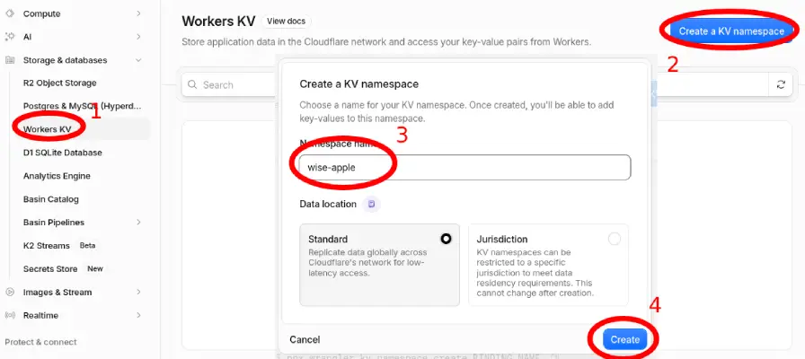
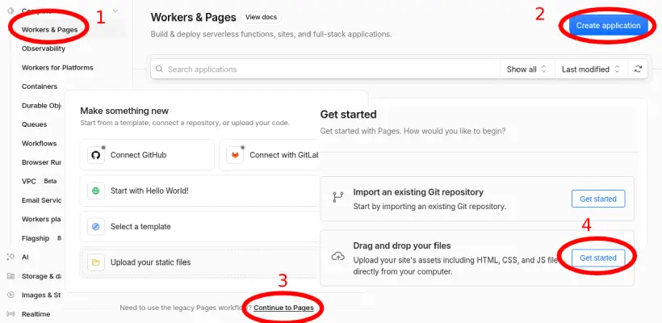
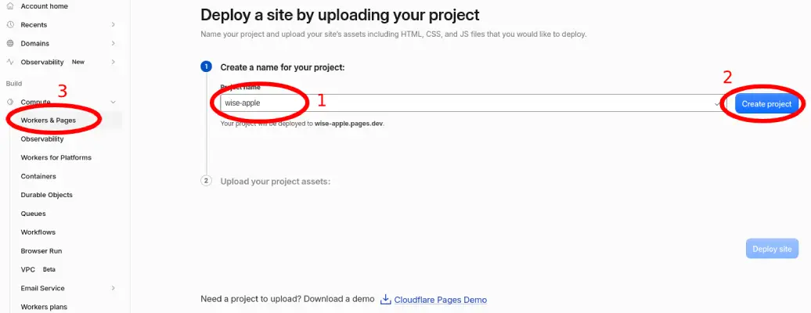
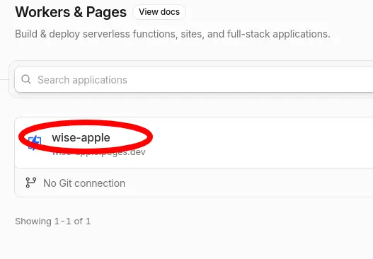
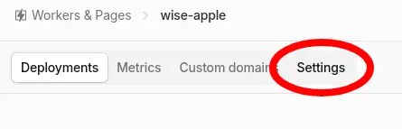
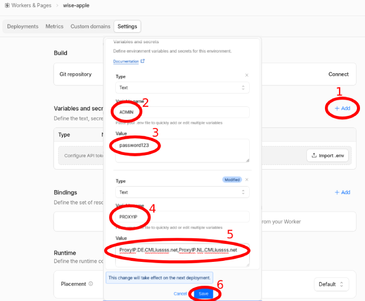
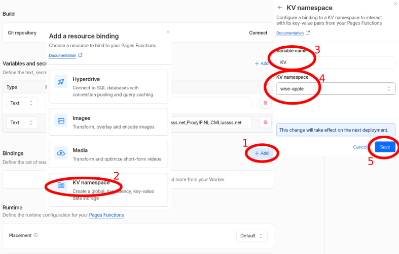
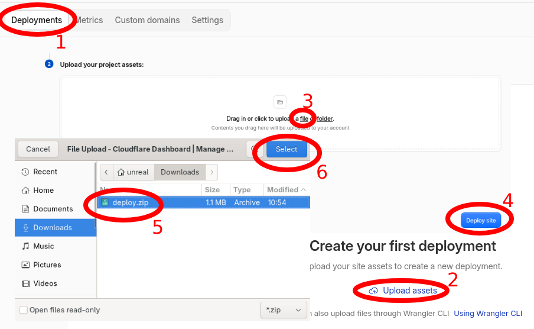
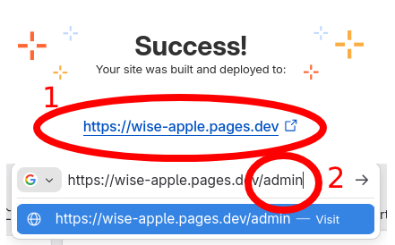
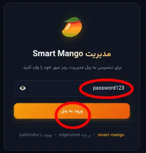

# 📖 راهنمای کامل و تصویری راه‌اندازی اسمارت منگو

این راهنما شامل تمامی مراحل گام‌به‌گام ساخت دیتابیس، تنظیم متغیرها، دیپلوی پروژه در کلادفلر و اتصال کلاینت‌ها می‌باشد.

---

## 🚀 مراحل راه‌اندازی در Cloudflare Pages

برای راه‌اندازی فقط به یک حساب کاربری رایگان در [Cloudflare](https://dash.cloudflare.com/) نیاز دارید. تمام مراحل شماره‌گذاری شده و مطابق تصاویر زیر است:

### ۱. دانلود فایل آماده
ابتدا فایل زیر را روی گوشی یا کامپیوتر دانلود کنید:  
👉 **[دانلود مستقیم آخرین نسخه deploy.zip](https://github.com/mehdichamani/smart-mango/releases/latest/download/deploy.zip)**

---

### ۲. ساخت دیتابیس (KV Namespace)
1. وارد حساب کلادفلر شوید و از منوی سمت چپ به مسیر **Storage & databases** > **Workers KV** بروید (۱).
2. روی دکمه آبی‌رنگ **Create a KV namespace** کلیک کنید (۲).
3. یک نام دلخواه انگلیسی بنویسید (مثلاً نام پروژه یا `mango_kv`) (۳).
4. دکمه **Create** را بزنید (۴).



---

### ۳. ایجاد پروژه خام در Pages (بدون نیاز به آپلود اولیه)
1. از منوی سمت چپ به **Compute** > **Workers & Pages** بروید (۱).
2. روی دکمه آبی‌رنگ **Create application** بزنید (۲).
3. روی گزینه **Continue to Pages** (یا تب Pages) کلیک کرده و در بخش **Drag and drop your files** دکمه **Get started** را بزنید (۳ و ۴).



4. یک نام دلخواه برای پروژه بنویسید (۱).
5. دکمه **Create project** کنار نام را بزنید (۲).  
   > [!NOTE]  
   > در این مرحله فایلی آپلود نکنید! با این روش، پروژه خام ساخته می‌شود تا متغیرها و دیتابیس را ابتدا تنظیم کنیم و نیازی به دیپلوی مجدد نباشد.
6. از منوی سمت چپ روی **Workers & Pages** کلیک کنید تا به صفحه قبل برگردید (۳).



7. از لیست، روی نام پروژه‌ای که ساختید کلیک کنید تا وارد تنظیمات آن شوید.  
   *(نکته: اگر نام پروژه را بلافاصله در لیست ندیدید، یک‌بار صفحه مرورگر را رفرش کنید تا ظاهر شود).*



---

### ۴. تعیین متغیرها (`ADMIN` و `PROXYIP`)
1. از تب‌های بالای صفحه وارد بخش **Settings** شوید.



2. در بخش **Variables and secrets** روی دکمه **+ Add** کلیک کنید (۱).
3. متغیر رمز عبور پنل را وارد کنید:
   - در **Variable name:** عبارت `ADMIN` را وارد کنید (۲)
   - در **Value:** یک رمز عبور دلخواه برای ورود به پنل (۳).
4. متغیر پروکسی‌آی‌پی (جهت پایداری و باز شدن روان سایت‌های پشت کلادفلر مثل ChatGPT) را وارد کنید:
   - در **Variable name:** عبارت `PROXYIP` را وارد کنید (۴)
   - در **Value:** مقدار `ProxyIP.DE.CMLiussss.net,ProxyIP.NL.CMLiussss.net` را وارد کنید (۵).
5. روی دکمه آبی‌رنگ **Save** کلیک کنید (۶).

> [!TIP]
> **دامنه شخصی (اختیاری):** اگر از قبل دامنه اختصاصی دارید، می‌توانید در همین بخش متغیر دیگری با نام `HOST` و مقدار دامنه خود (بدون `https://`) اضافه کنید تا در آینده نیز هرگز نیازی به دیپلوی دوباره نداشته باشید.



---

### ۵. اتصال دیتابیس به پروژه (KV Binding)
1. در همان تب **Settings**، در بخش **Bindings** روی دکمه **+ Add** کلیک کنید (۱).
2. گزینه **KV namespace** را انتخاب کنید (۲).
3. در کادر **Variable name** عبارت `KV` را وارد کنید تماما با حروف بزرگ (۳).
4. در کادر **KV namespace** همان دیتابیسی که در مرحله ۲ ساختید را انتخاب کنید (۴).
5. دکمه **Save** را بزنید (۵).



---

### ۶. بارگذاری فایل و راه‌اندازی (دیپلوی یک‌باره)
> [!TIP]
> چون متغیرها و دیتابیس را از قبل تنظیم کرده‌اید، با یک‌بار آپلود فایل پروژه بلافاصله با تمام امکانات راه‌اندازی می‌شود و **هیچ نیازی به دیپلوی مجدد نیست!**

1. از بالای صفحه وارد تب **Deployments** شوید (۱).
2. روی دکمه **Upload assets** کلیک کنید (۲).
3. روی گزینه **a file** کلیک کنید (۳).
4. فایل `deploy.zip` که در مرحله اول دانلود کردید را انتخاب کنید (۵).
5. دکمه **Deploy site** را بزنید تا سایت مستقر شود (۴ و ۶).



---

### ۷. ورود به پنل مدیریت
کار تمام شد! پروژه شما با موفقیت راه‌اندازی شد:
1. روی آدرس سایت کلیک کرده و در انتهای آن عبارت `/admin` را تایپ و اینتر بزنید:
   ```text
   https://your-project.pages.dev/admin
   ```



2. رمز عبوری که در متغیر `ADMIN` وارد کرده بودید را بنویسید و روی **ورود به پنل** کلیک کنید.



3. اکنون پنل شما آماده است و می‌توانید لینک‌های اشتراک مخصوص همراه اول و ایرانسل را کپی کرده و در برنامه متصل شوید.

---

## 🌐 اتصال دامنه شخصی (اختیاری اما مهم در ایران)

به دلیل اینکه آدرس‌های پیش‌فرض `pages.dev` در ایران دچار اختلال یا مسدود هستند، بهتر است یک دامنه شخصی به پروژه متصل کنید:

### ۱. ثبت دامنه در کلادفلر
1. در صفحه پروژه کلادفلر به تب **Custom domains** بروید.
2. روی دکمه **Set up a custom domain** کلیک کنید.
3. یک زیردامنه وارد کنید (مثلاً `sub.yourdomain.com`) و دکمه ادامه را بزنید.
4. کلادفلر بقیه تنظیمات DNS را به صورت خودکار انجام می‌دهد.

> [!TIP]
> می‌توانید چند دامنه یا ساب‌دامین مختلف اضافه کنید تا در صورت بروز اختلال روی یک آدرس، سایر آدرس‌ها بدون مشکل کار کنند.

### ۲. تعریف متغیر دامنه (`HOST`) – دائمی‌سازی تنظیمات
> [!WARNING]
> اگر دامنه را صرفاً از داخل پنل مدیریت تنظیم کنید، با هر بار آپدیت کدها تنظیمات پاک شده و ریست می‌شود. بنابراین اکیداً توصیه می‌شود دامنه را به‌صورت متغیر در کلادفلر تعریف کنید تا همیشگی بماند:

1. در صفحه پروژه به تب **Settings** > **Variables and Secrets** بروید.
2. در بخش **Production** روی **Add variable** بزنید:
   - **نام متغیر (Variable name):** `HOST`
   - **مقدار (Value):** آدرس دامنه شخصی‌تان بدون `https://` (مثلاً `sub.yourdomain.com`).
   *(اگر چند دامنه دارید، آن‌ها را با کاما `,` جدا کنید؛ مثلاً: `sub1.domain.com,sub2.domain.com`)*
3. دکمه **Save** را بزنید.
4. اگر متغیر `HOST` را در همان ابتدای کار (مرحله ۴ راهنمای راه‌اندازی) اضافه نکرده‌اید و اکنون اضافه می‌کنید، برای اعمال آن لازم است یک‌بار در تب **Deployments** فایل `deploy.zip` را مجدداً آپلود کنید.

---

## ⚡ افزایش سرعت و رفع اختلال با پروکسی‌آی‌پی (ProxyIP)

**پروکسی‌آی‌پی چیست و چرا لازم است؟**  
ورکرهای کلادفلر نمی‌توانند مستقیماً به سایت‌هایی که خودشان نیز از CDN کلادفلر استفاده می‌کنند (مانند ChatGPT، Discord و...) متصل شوند.  
متغیر `PROXYIP` یک سرور واسط (رله) خارج از کلادفلر است که ترافیک این سایت‌ها را عبور داده، لوکیشن خروجی را تنظیم می‌کند (مفید برای دور زدن تحریم‌های هوش مصنوعی) و خطای لود نشدن سایت‌ها یا کپچاهای پی‌درپی را رفع می‌کند.

> [!NOTE]
> آدرس `PROXYIP` ربطی به فیلترینگ داخل ایران ندارد (ارتباط کلادفلر با سایت مقصد است). بنابراین نگران فیلتر بودن این آدرس‌ها در ایران نباشید.

در بخش تنظیمات متغیر یا در پنل مدیریت، می‌توانید یکی از آدرس‌های لودبالانسر زیر (یا چند مورد با کاما `,`) را قرار دهید:
- `ProxyIP.DE.CMLiussss.net` (آلمان – کمترین پینگ و بالاترین سرعت)
- `ProxyIP.NL.CMLiussss.net` (هلند – پایداری بالا)
- `ProxyIP.US.CMLiussss.net` (آمریکا – مخصوص سرویس‌های تحریمی و هوش مصنوعی)
- `bpb.yousef.isegaro.com` (اروپا)

---

## 📲 نحوه افزودن لینک اشتراک در کلاینت‌ها

1. وارد پنل مدیریت خود (`/admin`) شوید و لینک اشتراک اپراتور مورد نظر خود (همراه اول، ایرانسل یا تجمیعی) را کپی کنید.
2. **در برنامه PattNG (اندروید):**
   - منوی کشویی سمت چپ را باز کرده و گزینه **Subscription group setting** را بزنید.
   - علامت **+** بالای صفحه را لمس کنید.
   - یک نام دلخواه در بخش **Remark** بنویسید و لینک را در **Optional URL** پیست کنید و ذخیره نمایید.
   - به صفحه اصلی برگشته، منوی سه‌نقطه بالا را بزنید و گزینه **Update subscription** را انتخاب کنید تا کانفیگ‌ها لود شوند.
3. **در برنامه PattN (ویندوز):**
   - از منوی بالای برنامه روی **Subscription group** و سپس **Subscription grouping setting** کلیک کنید.
   - روی دکمه **Add** زده، نام و آدرس لینک ساب را وارد کرده و **Confirm** را بزنید.
   - از همان منوی **Subscription group** گزینه **Update subscription** را انتخاب کنید.

> [!IMPORTANT]
> **نکته مهم درباره دامنه پیش‌فرض `pages.dev`:**  
> اگر دامنه اختصاصی متصل نکرده‌اید، به دلیل اینکه آدرس‌های پیش‌فرض `pages.dev` در ایران مسدود هستند، **هنگام افزودن یا به‌روزرسانی اولیه ساب (Update subscription) باید فیلترشکن دیگری موقتاً روشن باشد** تا لیست کانفیگ‌ها دریافت شود. پس از دریافت کانفیگ‌ها، اتصال آن‌ها به‌صورت مستقیم کار خواهد کرد. (با اتصال دامنه شخصی این محدودیت رفع می‌شود).

---

[⬅ بازگشت به صفحه اصلی README](README.md)
