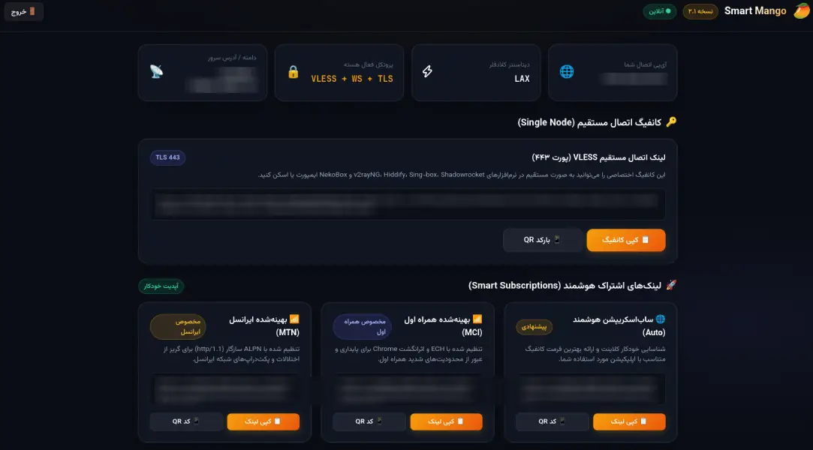

# 🥭 اسمارت منگو (Smart Mango)

**پنل رایگان دور زدن محدودیت‌های اینترنت ایران روی کلادفلر (Cloudflare Pages)**  
دسترسی ساده، رایگان و پرسرعت به اینترنت آزاد بدون نیاز به سرور مجازی و فقط با یک اکانت رایگان کلادفلر.

[📖 راهنمای تصویری راه‌اندازی](DEPLOYMENT.md) • [📥 دانلود deploy.zip](https://github.com/mehdichamani/smart-mango/releases/latest/download/deploy.zip) • [📲 کلاینت‌های پیشنهادی](#-کلاینت‌های-پیشنهادی)

---

## ✨ خلاصه قابلیت‌ها و بهبودها

این نسخه بر پایه پروژه [edgetunnel](https://github.com/cmliu/edgetunnel) با متدهای ضدفیلتر [پترنیها (patterniha)](https://github.com/patterniha) بومی‌سازی شده است:

- 🥭 **پنل کاملاً فارسی و سبک:** طراحی شیک، دارک‌مود، لود فوق‌سریع و بدون وابستگی به سرورهای خارجی.
- 📱 **اشتراک هوشمند همراه اول و ایرانسل:** لینک‌های بهینه‌شده مخصوص همراه اول (ECH) و ایرانسل برای اتصال پایدارتر.
- 🚀 **نصب آسان حتی با موبایل:** فایل آماده `deploy.zip` بدون نیاز به کدنویسی، لینوکس یا کامپیوتر.
- 🌐 **پشتیبانی کامل از IPv6 و ProxyIP:** رفع اختلالات اتصال کلادفلر و افزایش سرعت و پایداری در ایران.
- 🔑 **کانفیگ‌های متنوع:** ساخت آسان لینک‌های VLESS، Trojan و Shadowsocks همراه با بارکد QR.

---

---

## 🚀 شروع سریع (Quick Start)

برای راه‌اندازی بدون نیاز به سرور، مراحل زیر را طی کنید:

1. **دانلود فایل:** فایل [deploy.zip](https://github.com/mehdichamani/smart-mango/releases/latest/download/deploy.zip) را دانلود کنید.
2. **ساخت دیتابیس:** در کلادفلر به **Workers KV** رفته و یک دیتابیس بسازید.
3. **ایجاد پروژه:** در **Workers & Pages** یک پروژه خام Pages بسازید.
4. **تنظیمات:**
   - متغیر `ADMIN` (رمز ورود) و `PROXYIP` را در **Settings > Variables** اضافه کنید.
   - دیتابیس را در **Settings > Bindings** با نام `KV` متصل کنید.
5. **آپلود و دیپلوی:** فایل `deploy.zip` را در تب **Deployments** آپلود کرده و به مسیر `/admin` بروید.

> [!TIP]
> اگر بار اول است که این کار را انجام می‌دهید یا به توضیحات دقیق و تصاویر هر مرحله نیاز دارید:  
> 👉 **[مشاهده راهنمای کامل و گام‌به‌گام تصویری (DEPLOYMENT.md)](DEPLOYMENT.md)**

---

## 📲 کلاینت‌های پیشنهادی

برای دریافت بالاترین کارایی و اعمال صحیح تنظیمات بهینه‌شده اپراتورها، توصیه می‌شود از کلاینت‌های پترنیها استفاده کنید:

| سیستم‌عامل | کلاینت پیشنهادی | توضیحات |
| :--- | :--- | :--- |
| 📱 **اندروید** | [PattNG](https://github.com/patterniha/PattNG) | نسخه بهینه‌شده v2rayNG با تنظیمات مخصوص ایرانسل و همراه اول |
| 💻 **ویندوز** | [PattN](https://github.com/patterniha/PattN) | نسخه بهینه‌شده v2rayN برای پایداری و رفع اختلالات |

> نحوه افزودن لینک اشتراک در کلاینت‌ها را در [راهنمای کلاینت‌ها در DEPLOYMENT.md](DEPLOYMENT.md#-نحوه-افزودن-لینک-اشتراک-در-کلاینت‌ها) بخوانید.

---

## 🌐 نکات تکمیلی و مهم

- **دامنه شخصی:** به دلیل اختلال دامنه‌های `pages.dev` در ایران، توصیه می‌شود حتماً یک دامنه اختصاصی به پروژه متصل کرده و متغیر `HOST` را تنظیم کنید. [راهنمای اتصال دامنه](DEPLOYMENT.md#-اتصال-دامنه-شخصی-اختیاری-اما-مهم-در-ایران)
- **پروکسی‌آی‌پی (ProxyIP):** برای رفع خطای ورود به سرویس‌هایی نظیر ChatGPT و دیسکورد، از پروکسی‌آی‌پی استفاده کنید. [راهنمای ProxyIP](DEPLOYMENT.md#-افزایش-سرعت-و-رفع-اختلال-با-پروکسی‌آی‌پی-proxyip)

---

## 📜 مرجع و تشکر
- توسعه‌یافته بر پایه [edgetunnel](https://github.com/cmliu/edgetunnel)
- با قدردانی از تکنیک‌ها و متدهای بهینه‌سازی [پترنیها (patterniha)](https://github.com/patterniha).
